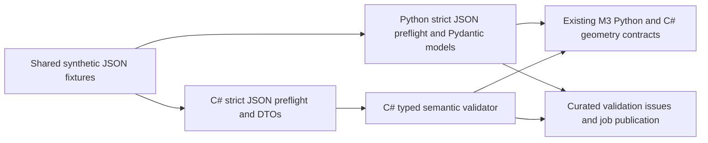
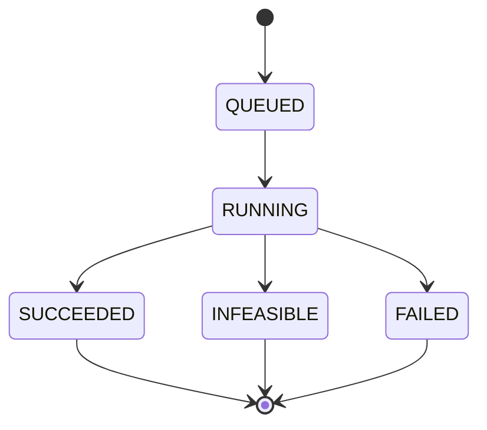

# BE-M6-D01 final development report

**Task:** Generation and Validation Contracts  
**Owner:** Member 6  
**Date:** 2026-11-19  
**Branch:** `feature/m6-ai-generation`  
**Latest tested backend (H4-R1):** `bf72343ce95655447b431c076dcf62d02c32c6de`  
**Verdict:** **PASS for provisional local D01 delivery. Ready for independent review. Production regulatory integration remains CORRECTIONS REQUIRED.**

## Executive summary and original scope

D01 delivers a compiling contract layer for metric land, generation input and output, feasibility, validation results, and generation job snapshots. Python and C# exercise one shared fixture corpus. Local verification closes the 22 recorded semantic cases and preserves explicit failure when the compute capability is unavailable. D01 establishes structural contracts before D02 footprint computation and later generation work.

The [M6 plan](../../second-brain/15-Member-Plans/M6-AI-GENERATION.md) calls for a shared geometry shape and compiling skeleton, rejection of malformed geometry and identities, and an explicit unavailable result without fabricated plans. Its coordination tasks include agreeing the M2 metric parcel and M3 geometry/validation interfaces, defining job and replay contracts with M4, using M5 requirements, and retaining independently sourced M7 provenance. Team signoff, migration planning and PR delivery remain separate gates.

## Implementation and acceptance matrix

| Work item | Delivered and verified | Disposition |
|---|---|---|
| Existing app and architecture | Contracts extend the footprint, generation and validation modules in the existing backend. C# contracts stay in Application. | **PASS** for local boundaries |
| Metric and revisioned input | Exact schema and nonnil UUID triplet, local Cartesian metres, closed finite rings, ground-floor synthetic catalogue, deterministic seed range | **PASS** for fixtures. M2/M5 handoffs pending |
| Geometry and responses | Existing M3 shape reused in both languages. Exact identities, local structural checks and explicit blocking diagnostics are verified. | **PASS** for supported fixtures. M3 compatibility and freshness pending |
| Honest unavailable or incomplete result | The unavailable example emits reason and critical diagnostic with zero alternatives. Incomplete validation blocks success. | **PASS** for the contract, including the explicit unavailable fixture |
| Job state, identity and replay metadata | Lifecycle, transition validation, immutable history, key/project/operation/fingerprint/seed consistency and curated publication | **PASS** for local snapshots. Atomic persistence and replay enforcement pending |
| Shared fixtures and runtime parity | Seven models, 13 positive fixtures, 34 variants, 38 representation and 82 semantic/boundary checks | **PASS** for the tested corpus. Shared runner registration pending |
| Resource limits and public errors | Duplicate-key preflight, bounded model fields and curated public diagnostics are verified locally. | **PASS** for local utilities. Raw transport and request budget pending |
| Build and regression | 10/10 Release projects. 2,288 non-repeated suite checks, of which 694 are M6-specific. | **PASS** |
| Team contract, migration and release approval | M2/M3/M4/M5/M7 handoffs and M1/M4 authorization still require review. No production activation or migration accompanied D01. | **PENDING** |

## Development chronology

| Phase | Evidence and outcome |
|---|---|
| D01-A — reconciliation | The phase brief records a read-only review of current FastAPI, M3 models, M4 interfaces and wire decisions. It carried forward 54 Python tests and 12 geometry smoke checks as historical baseline evidence. |
| D01-B — input | Implemented the metric parcel envelope, synthetic rooms, adjacency, evidence metadata and portable seed. The D01-C handoff records 196 M6 cases and 250 Python passes including 54 prior tests. |
| D01-C — responses | Added feasibility, validation, alternatives and explicit unavailable result. The D01-D handoff records 135 phase cases and 385 complete Python passes. |
| D01-D — lifecycle | Added snapshot states, timestamp ordering, registered diagnostics, failure rules and idempotency metadata. Source and tests establish contract coverage. No standalone D01-D execution count is attributed. |
| D01-E — C# DTOs | Added the four provisional DTO files and reused M3 geometry types. The D01-F handoff records 544 Python passes, including 490 M6 cases. It supplies no C# execution result. |
| D01-F — shared fixtures | Introduced the common corpus and C# representation scenarios. D01-G carried a 590-pass Python baseline and recorded 22 semantic gaps and three M3 omission differences. |
| D01-G / G1 / G2 — audit and hardening | Reviewed validation bypass, duplicate keys, public errors and unsafe publication. The final Python source and hardening tests show the corrections. The Step 10-A handoff records D01-G2 PASS, 628 total and 574 M6 Python passes, and 91 independent assertions. Those assertions are historical evidence outside the current totals. Separate G1/G2 execution logs were unavailable in the reviewed evidence. |
| Step 10-A — .NET recovery | Confirmed Ubuntu .NET availability, verified a 23-file backup, restored/built 10 projects and ran 681 solution tests and 246 registered console checks. M6 scenarios were still unregistered and did not run in this step. |
| Step 10-B — local parity | External runner passed 38 representation and 82 semantic/boundary cases. Both typed and JSON paths rejected all 22 gap fixtures. The raw overflow fixture helper and the curated-message test expectation were corrected and rerun successfully. The four added M6 files brought the overlay to 27. |
| H1 — synchronization audit | Verified a 27-file external backup and separate 19-ref Git bundle. Fetch identified `d5db6f8`, 11 commits ahead of the M6 baseline. No path collision was found and the active branch was preserved. |
| M4/M7 regulatory review | Audited retrieval PR #32 and its merged tree `af35a68`. M6 verdict was CORRECTIONS REQUIRED. CI #73 and the live no-corpus case establish transport behavior within their tested scope. |
| H2 — safe synchronization | Fetched and pinned `3af9eba`, which includes PR #34’s Windows provenance fix. The range from `fdf7baa` contains 13 commits and 180 changed files: 125 added and 55 modified. An external checkout passed regression before `git merge --ff-only`, and the active checkout passed again after it. No exact, case-only or file-versus-directory collision. |
| H3 — final audit | Inspected all 27 M6 files, the available historical briefs/handoffs, manifests, and retained H2 execution logs. Produced M6 review documentation without source changes or a new suite run. |

Early figures are labeled as handoff evidence. The H2 paired logs provide the final synchronized counts. See the [test evidence report](BE-M6-D01-TEST-EVIDENCE-REPORT.md) for detailed results and timing.

## Cross-language architecture and schema responsibilities



This diagram describes local code and test paths. The M4/M7 private retrieval service is a separate candidate source for advisory evidence. The reviewed-constraint provider and approved M6 transport adapter remain pending.

| Contract | Wire shape and responsibility |
|---|---|
| Metric land | `metric-land/0.1-draft`. Explicit Cartesian origin, units `m`, right/up axes, exterior and optional holes. |
| Generation input | `m6-generation-input/0.1-draft`. Project, land and requirements revisions, land, room slots, adjacency, regulatory evidence, Int32 seed. |
| Evidence | Required status, required nullable `ruleSetVersion`, constraints and gaps. Reviewed `setback` metadata carries rule and parcel-edge identity, distance in metres, applicability, reviewer and source references. |
| Feasibility | `m6-feasibility-result/0.1-draft`. Typed status, nullable footprint and m² measurements, policy/ruleset versions and diagnostics. |
| Validation | Candidate and validation IDs, revision triplet, lowercase geometry digest, nullable strict flags, ruleset and validator versions, UTC and blocking diagnostics. The draft type has no standalone `schemaVersion` member. |
| Generation result | `m6-generation-result/0.1-draft`. Outcome, nullable reason and algorithm version, seed, diagnostics, and revision-bound alternatives containing existing M3 draft geometry. |
| Generation job | `m6-generation-job/0.1-draft`. Job and correlation IDs, state, timestamps, fingerprint, idempotency metadata, optional result or failure. |

### Python implementation

Pydantic models forbid extra input and revalidate instances. The M6 boundary detects duplicate decoded keys at every depth before typed validation. It emits at most 20 safe fixed public issues without submitted values or internal exception detail. The result contract reuses M3 plan geometry with strict parsing and checks referential integrity. Snapshot publication revalidates mutable and constructed inputs, verifies supplied history for updates, and curates job diagnostics.

### C# implementation

The Application layer provides JSON DTOs with explicit wire property names, case-sensitive strict options and required/nullability rules. The opt-in boundary performs nested duplicate preflight, canonical GUID and UTC parsing, then typed semantic validation. Failed validation emits fixed public issues. Snapshot publication replaces diagnostic messages with curated values and strips submitted paths and references. Typed semantic calls and raw boundary calls both cover the recorded gap fixtures. The ordinary DTO serializer and the opt-in boundary have separate, documented UTC behavior.

### Semantic rules and limits

- **Input:** nonnil UUIDs, exact revision identity, finite coordinates and positive ordered room dimensions, seed 0 through 2,147,483,647, unique room slots, valid undirected adjacency pairs and parcel-edge indices. Local limits include 100 rooms, 4,950 adjacency entries, 10,000 points per ring, 100 holes and 1,000 constraints or gaps per collection.
- **Evidence:** `MISSING` requires gaps and carries no ruleset or constraints. `UNVERIFIED` and `CONFLICTING` require explicit gaps. `REVIEWED` requires a ruleset, reviewed constraints, known applicability and no gaps. These are envelope checks on supplied metadata. Reviewer authentication and legal currency remain external decisions.
- **Feasibility and validation:** unknown area remains `null` and computed empty area is zero. A positive footprint requires positive area. Feasible requires reviewed evidence and no critical diagnostic. Incomplete or failed candidate validation requires a critical diagnostic and a matching blocking flag.
- **Alternatives:** successful results require exactly three alternatives with distinct alternative, plan and validation IDs and distinct supplied signatures of one version. Alternative, geometry and validation identities must bind the same revisions, and validation must bind the candidate. Algorithms/rulesets agree where required. All non-success outcomes carry a reason and critical diagnostic with zero alternatives.
- **Jobs:** timestamps are ordered, active states have no terminal data, successful jobs carry only a matching successful result, and failures require registered supporting diagnostics. `INFEASIBLE` requires the declared buildable-area-shortfall reason. Search exhaustion is inconclusive. Update checks preserve identity, revision, correlation, seed, fingerprint, idempotency metadata and recorded history.

### Job lifecycle



Terminal states accept no further transitions. A replay returns the existing snapshot once the persistence layer enforces the key and effective-request identity. The present utilities validate the declared lifecycle and accept a caller-supplied prior snapshot for update validation.

### Representative request and response

The following is the complete synthetic request. Room dimensions are fixture inputs with no regulatory authority. [Generation input fixture](../../../python-services/tests/m6_contract/fixtures/generation-input.v0.1-draft.json)

```json
{
  "schemaVersion": "m6-generation-input/0.1-draft",
  "projectId": "10000000-0000-4000-8000-000000000001",
  "landRevisionId": "10000000-0000-4000-8000-000000000002",
  "requirementsRevisionId": "10000000-0000-4000-8000-000000000003",
  "seed": 42,
  "land": {
    "schemaVersion": "metric-land/0.1-draft",
    "coordinateSystem": {"type":"localCartesian","unit":"m","origin":{"x":0,"y":0},"xDirection":"right","yDirection":"up"},
    "boundary":{"exterior":[{"x":0,"y":0},{"x":10,"y":0},{"x":10,"y":8},{"x":0,"y":8},{"x":0,"y":0}],"holes":[]}
  },
  "roomProgram":{"level":0,"catalogueVersion":"synthetic-fixture-v1","rooms":[
    {"slotId":"10000000-0000-4000-8000-000000000004","roomType":"bedroom","dimensions":{"minWidthM":3,"minDepthM":3}}
  ]},
  "adjacencyPreferences": [],
  "regulatoryEvidence":{"status":"MISSING","ruleSetVersion":null,"constraints":[],"gaps":[{"code":"SETBACK_EVIDENCE_MISSING"}]}
}
```

The unavailable response fixture illustrates a truthful zero-alternative result. It is not bound to a deployed route. [Unavailable fixture](../../../python-services/tests/m6_contract/fixtures/generation-unavailable.v0.1-draft.json)

```json
{
  "schemaVersion": "m6-generation-result/0.1-draft",
  "projectId": "10000000-0000-4000-8000-000000000001",
  "landRevisionId": "10000000-0000-4000-8000-000000000002",
  "requirementsRevisionId": "10000000-0000-4000-8000-000000000003",
  "outcome": "UNAVAILABLE",
  "reasonCode": "GENERATION_UNAVAILABLE",
  "algorithmVersion": null,
  "seed": 42,
  "alternatives": [],
  "diagnostics": [{"code":"GENERATION_UNAVAILABLE","severity":"CRITICAL","message":"Plan generation is unavailable in this synthetic contract fixture."}]
}
```

## Inventory of the 27 implementation, test and fixture files

The manifest covers seven Python implementation files, seven C# contract files, eight Python test modules, three JSON fixtures and two C# scenario files.

| File | Role |
|---|---|
| [`python-services/app/geometry/footprint/__init__.py`](../../../python-services/app/geometry/footprint/__init__.py) | Footprint package marker |
| [`python-services/app/geometry/footprint/contracts.py`](../../../python-services/app/geometry/footprint/contracts.py) | Strict model base, metric land, diagnostic and feasibility models |
| [`python-services/app/plans/generation/__init__.py`](../../../python-services/app/plans/generation/__init__.py) | Generation package marker |
| [`python-services/app/plans/generation/contracts.py`](../../../python-services/app/plans/generation/contracts.py) | Generation input, reviewed metadata, alternative and result models |
| [`python-services/app/plans/generation/job_contracts.py`](../../../python-services/app/plans/generation/job_contracts.py) | Job states, diagnostic registry, transitions and safe publication |
| [`python-services/app/validation/boundary.py`](../../../python-services/app/validation/boundary.py) | Duplicate-key preflight and fixed public validation messages |
| [`python-services/app/validation/contracts.py`](../../../python-services/app/validation/contracts.py) | Validation result, strict flags, hashes and UTC rules |
| [`python-services/tests/m6_contract/fixtures/generation-input.v0.1-draft.json`](../../../python-services/tests/m6_contract/fixtures/generation-input.v0.1-draft.json) | Synthetic request |
| [`python-services/tests/m6_contract/fixtures/generation-unavailable.v0.1-draft.json`](../../../python-services/tests/m6_contract/fixtures/generation-unavailable.v0.1-draft.json) | Explicit unavailable result |
| [`python-services/tests/m6_contract/fixtures/parity/shared-contract-cases.json`](../../../python-services/tests/m6_contract/fixtures/parity/shared-contract-cases.json) | Shared positive and mutated wire cases |
| [`python-services/tests/m6_contract/test_contract_hardening.py`](../../../python-services/tests/m6_contract/test_contract_hardening.py) | Boundary, mutation, state history and redaction tests |
| [`python-services/tests/m6_contract/test_diagnostic_contracts.py`](../../../python-services/tests/m6_contract/test_diagnostic_contracts.py) | Registry classification and job failure diagnostics |
| [`python-services/tests/m6_contract/test_feasibility_contracts.py`](../../../python-services/tests/m6_contract/test_feasibility_contracts.py) | Feasibility and diagnostic invariants |
| [`python-services/tests/m6_contract/test_generation_contracts.py`](../../../python-services/tests/m6_contract/test_generation_contracts.py) | Input schema, bounds and reference tests |
| [`python-services/tests/m6_contract/test_generation_job_contracts.py`](../../../python-services/tests/m6_contract/test_generation_job_contracts.py) | State, transition and idempotency tests |
| [`python-services/tests/m6_contract/test_generation_response_contracts.py`](../../../python-services/tests/m6_contract/test_generation_response_contracts.py) | Alternatives, validation and explicit failures |
| [`python-services/tests/m6_contract/test_shared_contract_fixtures.py`](../../../python-services/tests/m6_contract/test_shared_contract_fixtures.py) | Python execution of shared fixtures |
| [`python-services/tests/m6_contract/test_validation_contracts.py`](../../../python-services/tests/m6_contract/test_validation_contracts.py) | Candidate validation and blocking-state tests |
| [`src/BuildMind.Application/Features/Generation/Contracts/FeasibilityContracts.cs`](../../../src/BuildMind.Application/Features/Generation/Contracts/FeasibilityContracts.cs) | Metric land, evidence and feasibility DTOs |
| [`src/BuildMind.Application/Features/Generation/Contracts/GenerationContractBoundary.cs`](../../../src/BuildMind.Application/Features/Generation/Contracts/GenerationContractBoundary.cs) | Strict duplicate preflight, canonical GUID/UTC converters and safe issues |
| [`src/BuildMind.Application/Features/Generation/Contracts/GenerationContractValidation.cs`](../../../src/BuildMind.Application/Features/Generation/Contracts/GenerationContractValidation.cs) | Typed semantic validation |
| [`src/BuildMind.Application/Features/Generation/Contracts/GenerationContracts.cs`](../../../src/BuildMind.Application/Features/Generation/Contracts/GenerationContracts.cs) | Generation input, result and alternative DTOs |
| [`src/BuildMind.Application/Features/Generation/Contracts/GenerationJobContracts.cs`](../../../src/BuildMind.Application/Features/Generation/Contracts/GenerationJobContracts.cs) | Job, idempotency and registered diagnostic DTOs |
| [`src/BuildMind.Application/Features/Generation/Contracts/GenerationJobPublication.cs`](../../../src/BuildMind.Application/Features/Generation/Contracts/GenerationJobPublication.cs) | Transition validation and curated publication |
| [`src/BuildMind.Application/Features/Generation/Contracts/ValidationContracts.cs`](../../../src/BuildMind.Application/Features/Generation/Contracts/ValidationContracts.cs) | Shared revision, validation DTOs and strict DTO serializer options |
| [`tests/BuildMind.Application.ContractTests/Integration/M6GenerationContractScenarios.cs`](../../../tests/BuildMind.Application.ContractTests/Integration/M6GenerationContractScenarios.cs) | Representation scenarios |
| [`tests/BuildMind.Application.ContractTests/Integration/M6SemanticContractScenarios.cs`](../../../tests/BuildMind.Application.ContractTests/Integration/M6SemanticContractScenarios.cs) | Semantic and boundary scenarios |

## Technical and security audit

| Classification | Finding and disposition |
|---|---|
| Verified corrections | Python boundary preflight rejects duplicate keys before deserialization, model revalidation rejects structurally invalid copies and mutations, and safe formatting removes input and context. C# exercises nested escaped duplicates, malformed Unicode, explicit claim limits, state history, registered diagnostics and field redaction. |
| Verified closure | **22/22** recorded cases rejected locally. The cases cover identity/schema (3), numeric and geometry bounds (5), evidence and binding (4), job state and history (7), and alternatives (3). The [standalone case matrix](BE-M6-D01-TEST-EVIDENCE-REPORT.md#closure-of-the-22-recorded-semantic-gaps) lists the exact mutations and read paths. |
| High — production boundary | Raw JSON still needs M4 service-level byte limits and strict raw validation before DTO conversion. Local parsers and model caps do not enforce a transport budget or replace authenticated ingress. A caller that publishes a standalone snapshot also has no proof of prior history. Updates require a trusted prior state and an atomic store boundary. |
| Medium — additional static parity finding | Some inherited numeric fields are wider in Python than in C#. M3 draft `Floor.level` is a Python integer and a C# Int32. Standalone M6 regulatory evidence likewise accepts an unbounded nonnegative `parcelEdgeIndex` in Python, with Int32 in C#. Generation input limits edge indices to the actual exterior ring, so that path does not expose the standalone difference. Agree wire ranges with M3/M6 and add shared cases before wider adoption. These differences are outside the original 22 and were identified by static inspection in H3. |
| Medium — known representation differences | M3 Python defaults omitted rooms, walls and openings, while C# requires all three collections. The original C# DTO serializer uses `+00:00`, and the opt-in publisher uses `Z` after UTC normalization. Preserve these explicit verification results until wire ownership is agreed. |
| Low — retained verification boundaries | Correlating hashes, signatures, metrics and provenance to real computation is later work. Exact fixture cases establish structural results. Ring closure alone provides no topology or parcel containment guarantee. |
| Source audit | Targeted credential-pattern scan and inspection found no hardcoded credentials in the M6 files. The visible secret marker is synthetic test data. There is no M6 production endpoint, DI hook, worker, database mapping or shared runner registration. No blocking defect was identified on the supported local D01 fixture path. |

## Verification and backup

Step 10-A recovered C# execution using WSL **3.0.5.0**, kernel **6.18.58.1** on x86-64, Ubuntu **24.04.5 LTS**, native Linux SDK **10.0.115**, and .NET and ASP.NET Core runtimes **10.0.15**. The earlier Windows SDK was **9.0.318**. H2 verified SDK 10.0.115 for both runs. C# targets `net10.0` and uses existing references. Python 3.13 tests and both dependency checks passed without dependency-manifest changes by M6.

The synchronized counts were **1,196 solution, 276 shared console, 38 M6 representation, 82 M6 semantic/boundary, 628 Python and 68 RAG checks**, totaling **2,288** without repeats. The **574** M6 Python cases are within 628. The M6 total is **694**. Before synchronization the Step 10-B results were 681 solution and 246 shared checks, with the same M6 and Python counts. Full durations, suite breakdown, evidence limitations and operation-specific logs are in the [test evidence report](BE-M6-D01-TEST-EVIDENCE-REPORT.md).

The external Step 10-A and 10-B snapshots each record 23 files. H1 records the final 27-file overlay in `m6-sha256.csv` and the complete `committed-history.bundle` separately. H1 verified the 19-ref bundle by import and `git fsck --full`. H2 rechecked the original and external file hashes and bundle digest before and after fast-forward. H3 rechecked the hash evidence and did not alter the source overlay or backups. The H2 external directory contains the full incoming commit/file inventory and paired regression logs.

## M4/M7 disposition and cross-member dependencies

Original assessment before PR #35: **CORRECTIONS REQUIRED** — **2 PASS**, **6 PARTIAL**, **4 FAIL**. C06 (no fabricated limits) and C07 (M6 deterministic authority) passed. C02/C03/C05/C09/C10/C12 were partial. C01/C04/C08/C11 failed because that implementation lacked a versioned reviewed constraint provider, verified numeric rules, exact cross-service evidence binding, and a compatible structured M6 adapter. The H4-R1 review below supersedes those condition verdicts. Retrieved passages remain advisory, including when source hashes and offsets match.

| Owner | Remaining decision or prerequisite |
|---|---|
| M1/M4 | Atomic authenticated project ownership and exact revision access, with intentional race and denial behavior. |
| M2 | Confirmed metric parcel schema, CRS/local-origin handoff, jurisdiction and applicability inputs, and reliable parcel-edge identity. |
| M3/M6 | Explicit collection requiredness, timestamp serialization and integer domain decisions. Agree editor candidate binding, validation evidence freshness and version checking. |
| M5/M6 | Versioned mapping from saved room counts and type relationships to room slots, dimensions and adjacency. Define unsupported inputs. |
| M7/M6/lead | Reviewed numeric constraint provider with units, document/page/clause provenance, reviewer and coverage metadata. Bind an immutable evidence pack to the exact input revisions and evaluated candidate. |
| M4/M6/M7 | Strict raw transport, request limits, safe errors, authenticated private service rollout and rotation, bounded timeouts, protected hosting and cross-service security verification. |
| M4/M6 | Atomic job publication, storage and replay enforcement including uncertain-commit reconciliation. Any migration requires separate M4 coordination. |
| Harness owner / QA | Approve shared harness registration. Execute real-corpus, reviewed-evidence end-to-end and database-dependent suites only in approved isolated environments. |

## PR readiness and D02 prerequisites

The contract implementation and documentation are **ready for Captain and independent QA review**. The [local PR draft](BE-M6-D01-PR-SUMMARY.md) records scope and reviewer checks. H4 authorization, owner reviews and integration decisions remain pending. This report gives no production, spatial, legal or regulatory certification.

Before D02 footprint work, agree the confirmed metric parcel shape and edge references with M2, define the supported reviewed metric setback inputs with M7 and the lead, and agree required-area and missing-evidence outcomes with M5/M6. Define the independent topology, containment, valid-empty and unsupported-polygon tests. Begin from authorized fixtures and retain `NEEDS_REVIEW` for incomplete applicable evidence. Actual generation, geometric computation, canonical digest calculation, verified diversity, evidence retrieval integration and persistence are later work.

**Final technical verdict: PASS for the provisional D01 contract delivery and H3 audit. Shared production integration and H4 delivery are gated.**

## H4-R1 correction review and synchronization

**Pinned backend:** `bf72343ce95655447b431c076dcf62d02c32c6de` (PR #35). The previously tested H2 base was `3af9eba4983cc5a3a26fef0ea188cf47cf09b252`. The incoming range contained one commit, 30 files (9 added and 21 modified), and no collision with any of the 30 M6 paths. Windows Git timed out opening GitHub TCP 443 after DNS resolved. The bounded WSL Git fetch succeeded against the same HTTPS origin with TLS verification left in place. The isolated checkout passed before the active branch fast-forwarded to that exact commit.

### PR #35 technical disposition

The M7 provider implements `constraints-0` with a versioned table, seven typed kinds, per-kind review states and a synthetic marker. It reconstructs cited excerpts against the verified corpus at startup and serves the pack through an authenticated route. Retrieval remains separate. The C# port verifies the requested revision triplet, project revision, jurisdiction and kinds on receipt. M4 added streamed request limits for the RAG POSTs, raw duplicate-property rejection, strict response parsing before DTO validation, duplicate-token rejection and an HTTPS startup check for token-bearing non-loopback services outside Development, subject to the configured plaintext exception.

**Regulatory integration remains CORRECTIONS REQUIRED.** This review moves the assessment from 2 PASS / 6 PARTIAL / 4 FAIL to **3 PASS / 9 PARTIAL / 0 FAIL**. PASS applies only to the listed condition and the verified scope.

| Condition | Previous | H4-R1 | Evidence and remaining limit |
|---|---|---|---|
| C01 | FAIL | PASS | Versioned <code>constraints-0</code> endpoint, structured table, typed C# port and shared fixture. |
| C02 | PARTIAL | PARTIAL | Document hash, page, offsets and excerpt are reconstructed. Explicit clause identity and domain provenance signoff are pending. |
| C03 | PARTIAL | PARTIAL | Exact jurisdiction, building use and conditions are represented. Parcel facts, edge mapping and precedence remain unresolved. |
| C04 | FAIL | PARTIAL | The synthetic table tests reviewer metadata, comparators, ranges and units. A vetted real table and reviewer authority are unverified. |
| C05 | PARTIAL | PARTIAL | Missing, conflicting, unverified and verified states are present. Conflict detection is limited to matching scopes, and M6 outcome mapping is pending. |
| C06 | PASS | PASS | Provider uses a separate table and does not promote retrieved passages to constraints. Fixtures are explicitly synthetic. |
| C07 | PASS | PASS | The provider supplies data. M6 retains deterministic feasibility and candidate validation. |
| C08 | FAIL | PARTIAL | The client checks the echoed revision binding and provider emits a digest. Digest verification, revision-width alignment and propagation through M6 jobs remain open. |
| C09 | PARTIAL | PARTIAL | Repeated token headers are rejected and non-loopback token calls prefer HTTPS outside Development. RAG opt-out, the plaintext exception and Python-service auth require deployment agreement. |
| C10 | PARTIAL | PARTIAL | Tests cover caller cancellation, client timeout and safe unavailability. No end-to-end proof of bounded server work or credential-error operations. |
| C11 | FAIL | PARTIAL | Python and C# provider consume the shared example. M6 mapping, condition-unit/range parity and strict case and numeric typing remain open. |
| C12 | PARTIAL | PARTIAL | Local database-free and synthetic checks and upstream CI evidence are available. Approved real rules, persisted jobs and reviewed-evidence M6 end-to-end coverage remain unexecuted. |

### Corrections still required before M6 use

- **M7 and lead:** agree verified clause identity, reviewer identity and authority, real-table custody and provenance, Gazette/council precedence, and how overlapping or equivalent condition scopes are reconciled. The provider currently identifies conflicts within equal serialized scopes. A cited synthetic value, or an unresolved scope conflict, cannot become a blocking real rule.
- **M4 and M7:** define the canonical hash contract and verify it on receipt. The C# client currently checks the digest's form and echoed binding without recomputing the digest. Align the provider's Int32 project revision with M1's Int64 revision. Test field-to-unit rules and numeric ranges on both sides, plus conflicting packs and numeric-token and exact-case behavior. C# currently uses web serializer defaults for casing and reading numbers from JSON strings.
- **M4, M6 and M7:** close the Python-service authentication rollout and verify the deployment transport policy. RAG's environment setting can disable inbound auth, and the shared client has an explicit plaintext network exception. Use fixed validation locations/messages for public service errors since the current RAG formatter can reflect submitted property names. Retain client timeout and safe errors while verifying server cancellation or resource bounds.
- **M2, M5, M6 and M7:** map exact jurisdiction, approved conditions and reviewer/citation metadata to the actual parcel and revision-bound M6 setback representation. The provider's snake_case pack, review roles and structured kinds do not replace M6's camelCase evidence envelope, reviewer UUID or explicit exterior parcel-edge index. Preserve `NEEDS_REVIEW` where applicable evidence is incomplete. Bind the verified pack through validation, job identity and atomic publication with M4.
- **M6 and QA:** preserve deterministic validation authority and advisory-only retrieval, resolve shared harness registration and the previously documented M3 collection, timestamp and integer concerns, and run approved real-corpus, database and cross-service acceptance tests.

PR #35's upstream port registration is part of the synchronized backend. H4-R1 introduced no production M6 consumer, endpoint, regulation table or deployment configuration. The source is ready for a provisional contract PR once H4 publication is explicitly reauthorized.

### H4-R1 execution verdict

**PASS for backend synchronization and local regression.** Isolated and active Release builds passed 10/10 projects with zero warnings and errors on Ubuntu .NET 10.0.115. Both runs passed 1,234 database-free C# solution tests, 276 shared console checks, 120 isolated M6 C# checks (38 representation and 82 semantic/boundary), 628 Python tests including 574 M6 tests, and 139 RAG synthetic-corpus tests. Both dependency checks passed. There are **2,397** non-repeated suite checks and **694** M6-specific checks. See the [updated test evidence](BE-M6-D01-TEST-EVIDENCE-REPORT.md#h4-r1-regression-after-pr-35). Real-corpus and database-dependent acceptance were outside the M6 run.

All 27 M6 source, test and fixture hashes match the H4 manifest. The three documentation updates preserve the old evidence as history. The 30-file H4 backup and the historical bundle remain intact. H4 publication awaits explicit authorization.
