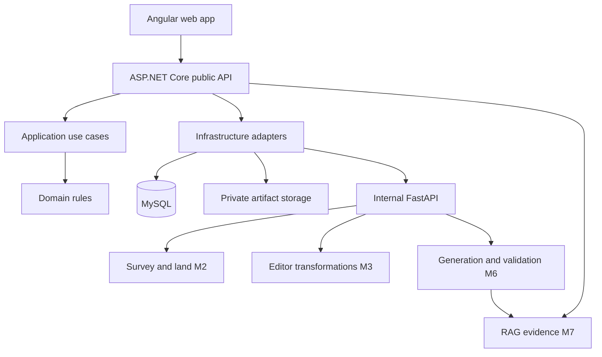

# Runtime and Clean Architecture

Compile-time: Domain has no outward dependency. Application -> Domain. Infrastructure -> Application/Domain as needed. API -> Application/Infrastructure composition root. No cycles. API endpoints translate transport, Application orchestrates use cases, Domain protects invariants, Infrastructure implements ports. Python is not a separate public customer backend. Internal routes protected by network and authenticated service identity. C# owns customer identity, state, transactions and persistence. Computational Python functions operate on explicit snapshots and return structured results, not direct changes to MySQL customer state.

Existing starter layout historically observed: `src/BuildMind.API`, `src/BuildMind.Application`, `src/BuildMind.Domain`, `src/BuildMind.Infrastructure`, `python-services/app`, `rag-service`, `tests`, `docs`. Inspect actual current tree. Do not create duplicate `backend/` wrapper or another FastAPI application. Prefer vertical feature folders under Application and separate endpoint classes. M4 is composition-root/DbContext/migration custodian; proposed M6 Python bootstrap custodian; M7 owns RAG and lead coordination. See [ownership](10-OWNERSHIP.md).

## Implemented composition — BE-M4-D01a (2026-11-17, uncommitted, pending review)
- `BuildMind.sln` (classic format) registers the four `src` projects and `tests/BuildMind.Infrastructure.Tests`.
- `BuildMind.Application.DependencyInjection.AddApplication(IServiceCollection)` and `BuildMind.Infrastructure.DependencyInjection.AddInfrastructure(IServiceCollection, IConfiguration)` are the layer registration entry points; both currently register nothing (no feature handlers, persistence or clients yet).
- `Program.cs` is the only composition root: `AddApplication().AddInfrastructure(configuration)`, `GET /health` (liveness only), `public partial class Program` for test hosting. Readiness is not mapped (BE-M4-D04).
- Packages added: Application → `Microsoft.Extensions.DependencyInjection.Abstractions` 10.0.12; Infrastructure → that plus `Microsoft.Extensions.Configuration.Abstractions` 10.0.12. Domain has no packages or project references.
- Dependency rules are enforced by `LayerDependencyTests` (declared and compiled references, no cycles, only API references Infrastructure). Local execution currently blocked (G17).

## Implemented composition — BE-M4-D01c (2026-11-18; merged to `develop` as `0a4d70a` via PR #11, CI passed, independent review outstanding)
- `Program.cs`: `AddApplication().AddInfrastructure(configuration).AddBuildMindApiInfrastructure(configuration)`; middleware `UseExceptionHandler()` → `UseStatusCodePages()`; `GET /health` unchanged; `MapBuildMindApiV1()` maps DI-registered `IApiEndpointModule` implementations under `/api/v1`.
- Application: `Abstractions/ICurrentUser.cs`, `Abstractions/Errors/SharedErrorCodes.cs`, `Abstractions/Errors/UnauthenticatedAccessException.cs` (no ASP.NET Core reference — enforced by `LayerDependencyTests.Inner_layers_do_not_reference_aspnetcore`).
- Infrastructure: `TimeProvider.System` registration; `Configuration/ServicesOptions.cs`, `InternalServiceOptions.cs` (types + validation rules only).
- API: `Errors/` (Problem Details, exception handler, validation helpers, trace IDs), `Routing/`, `Security/HttpContextCurrentUser.cs`, `Configuration/ServicesOptionsValidation.cs`, `ApiServiceCollectionExtensions.cs`.
- Details and decision mapping: [17-SHARED-CONVENTIONS-PROPOSAL §21](17-SHARED-CONVENTIONS-PROPOSAL.md).

## Persistence foundation — BE-M4-D02a (2026-11-18, uncommitted, awaiting review)

Infrastructure owns `BuildMindDbContext`, `MySqlContextOptions`, the design-time factory, the internal `TransactionRunner` and `PersistenceErrorClassifier`. The API binds `DatabaseOptions` and validates them at start-up (C8). Domain and Application stay free of EF Core and MySQL references, enforced by `LayerDependencyTests`. The database is disabled by default. There are no feature mappings or migrations yet, and the application never migrates itself. Details: [18 §D02a](18-MYSQL-PROVIDER-STUDY.md).

## Persistence adapters — BE-M4-D03 (uncommitted)

Infrastructure maps **persistence records** (`Persistence/Records`), never domain types. Mappers rebuild domain objects through their validating constructors (no reflection). Repositories implement existing Application ports inside `TransactionRunner`. First adapter: `RequirementRevisionRepository` (M5 port). See [22](22-M4-D03-SCHEMA-REGISTER.md).

## Internal service integration — BE-M4-D05 (uncommitted)

`Infrastructure/Integration/InternalServiceClient` (BCL `HttpClient`) is the only path to private services; feature clients wrap it (`PythonServiceClient`). The API composition root wires it through `IHttpClientFactory` with a hardened `SocketsHttpHandler`. Failures surface as Application `DependencyFailureException` (Problem Details 503/504). Readiness uses the same client for Python's confirmed `/health`. Feature routes, internal authentication (G11) and `/internal/v1` are pending; nothing is invented.

Details, audit and smoke-test proposal for the internal integration: [23](23-M4-D05-INTERNAL-INTEGRATION.md).
